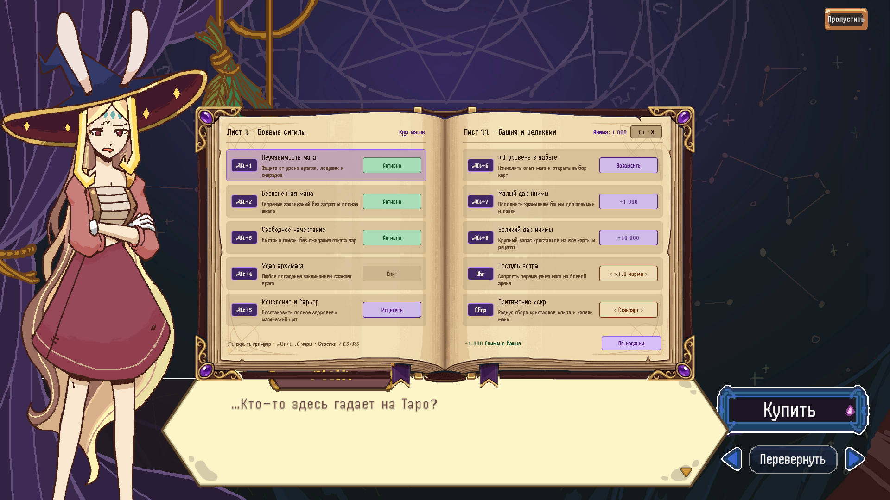
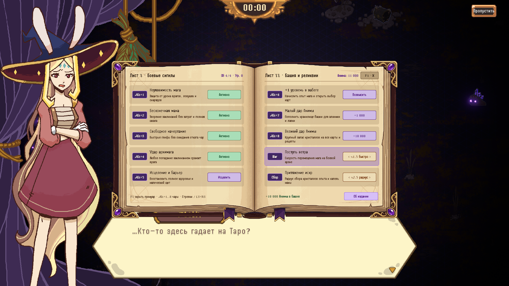
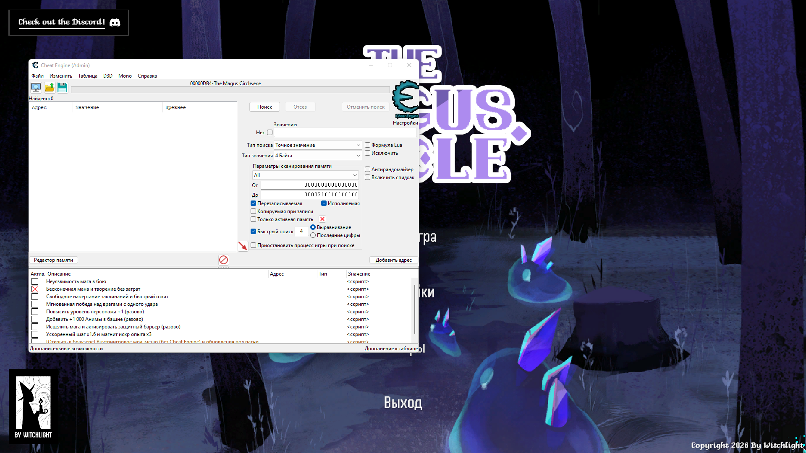

# The Magus Circle - Мод-меню в стиле гримуара и таблица Cheat Engine (v1.0)

Мод-меню в виде раскрытого двухстраничного гримуара на русском и таблица Cheat Engine для **The Magus Circle** (сборка `26344172`, Windows, Steam Deck и macOS).

## Скачать
- **[Сборка 2-в-1 и отдельное мод-меню на Boosty](https://boosty.to/cd_tixo/posts/1156f6fc-0f95-4945-845f-a1da765de3fe)** (ранний доступ: подписка `120 ₽/мес` на все релизы или разовый пост `150 ₽`, откроется всем **28 ноября 2026 в 18:00 UTC+10**)
- **[Таблица .CT на GitHub Releases](https://github.com/neoru-droid/the-magus-circle-mod-ru/releases)** · **[Чистый русификатор текста](https://github.com/neoru-droid/the-magus-circle-ru)**
- **Ранний доступ и заказ своей игры:** новинки на 7 дней раньше (подписка `120 ₽/мес` на все релизы или разовый пост `150 ₽`), своя игра в очередь - `350 ₽`, разбор вне очереди - `750 ₽` на [Boosty](https://boosty.to/cd_tixo)
- **Обновления и новые релизы в Telegram:** [@neoru_droid](https://t.me/neoru_droid)

## Возможности мод-меню

- **Бой и магия (`Alt+1..6`):** неуязвимость героя, бесконечная мана, свободное творение заклинаний, +1 уровень персонажа, +1 000 Анимы и +5 перебросов наград.
- **Поле боя и темп:** мгновенное завершение круга (`Alt+7`), очистка врагов на экране (`Alt+8`), скорость бега (`x1.0 / x1.5 / x2.2`), магнит искр опыта `x5` и скорость игры (`x1.0 / x1.5 / x2.0`).
- **Управление:** книга открывается по `F1`, `F2` или `L3 + R3` на геймпаде; навигация работает мышкой, стрелками и крестовиной.

## Таблица Cheat Engine (`TheMagusCircle_RU_v1.0.CT`)

Русская таблица для Cheat Engine 7.5+ (`TheMagusCircle-CheatTable-RU-v1.0.zip`) подключается к процессу `The Magus Circle.exe`: неуязвимость, бесконечная мана, свободное начертание заклинаний, победа с одного удара, +1 уровень, +1 000 Анимы, полное исцеление, шаг `x1.6` и магнит искр `x3`.

## Установка

1. **Windows:** закройте игру, распакуйте архив и запустите `TheMagusCircle-Trainer-Setup.exe` -> «Установить мод-меню».
2. **Steam Deck / Linux:** выполните `sh install-steamdeck.sh` (в параметрах запуска Steam укажите `WINEDLLOVERRIDES="version=n,b" %command%`).
3. **macOS:** запустите `install-macos.command`.
4. **Откат:** нажмите «Удалить мод-меню» в установщике (или флаг `--uninstall`).

Все проекты автора: [сайт каталога](https://neoru-droid.github.io/) · [каталог на Boosty](https://boosty.to/cd_tixo) · [Telegram](https://t.me/neoru_droid) · [профиль на GitHub](https://github.com/neoru-droid)

Лицензия: [MIT](LICENSE)
